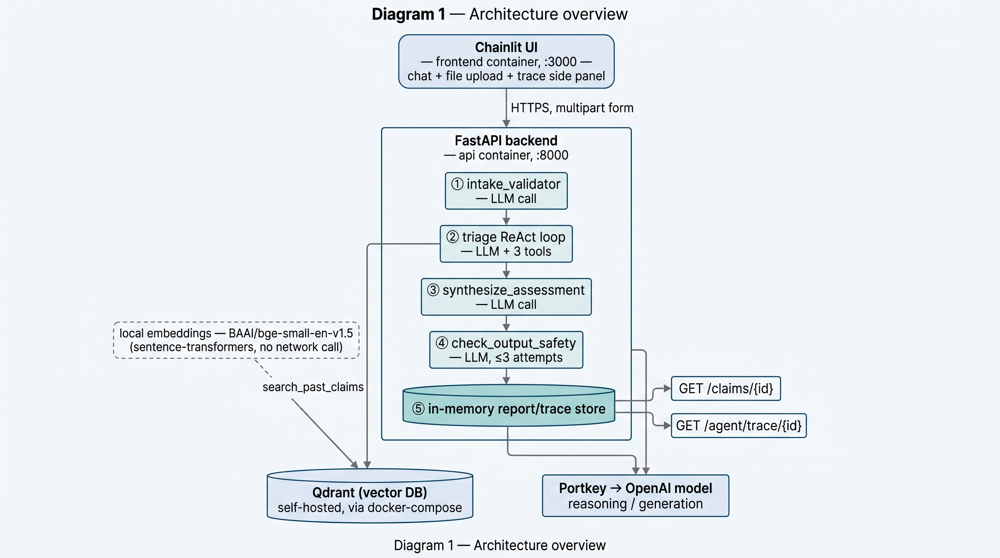

# Claim Triage Agent

A multi-agent system that takes a home-damage claim submission (photo, text description, optional PDF) and produces a structured triage report for an insurance adjuster, backed by a vector-retrieval knowledge base of historical claims and an observable ReAct tool-use loop. Built against the spec in [assignment.md](assignment.md) and [starter-kit/api-contract/openapi.yaml](starter-kit/api-contract/openapi.yaml).

## Architecture overview



Chainlit UI → FastAPI backend (intake validation → ReAct triage loop with three tools → synthesis → output safety check, with bounded regeneration) → structured report. Historical claims are embedded locally and retrieved from Qdrant via `search_past_claims`; `estimate_repair_cost` and `check_coverage` are deterministic lookups. All three services (`qdrant`, `api`, `ui`) run via `docker compose`; LLM calls are served through OpenRouter's OpenAI-compatible API (`OPENROUTER_API_KEY`, `OPENROUTER_BASE_URL`, `LLM_MODEL` in `starter-kit/.env`).

**API surface** (`starter-kit/api-contract/openapi.yaml`): `POST /api/v1/claims/triage`, `GET /api/v1/claims/{id}`, `GET /api/v1/agent/trace/{id}`, `GET /api/v1/health`.

## Setup

From `starter-kit/`:

```sh
make setup   # build + start qdrant, api, ui; embeds the historical-claims corpus into Qdrant
make test    # backend (tests/backend) + frontend (tests/frontend) unit suites
make grade   # public auto-grader (make grade-smoke for a fast 3-case subset while iterating)
make eval    # retrieval-quality eval for search_past_claims (backend/evals/)
```

API: `http://localhost:8000/api/v1/health` · UI: `http://localhost:3000`.

## Model, framework and vector DB choices

- **LLM: an OpenAI-compatible model served via OpenRouter** (`OPENROUTER_API_KEY`, `OPENROUTER_BASE_URL`, `LLM_MODEL` in `.env`). Used for every "intelligent" step: intake validation (vision + text), the ReAct triage loop's reasoning/tool-selection, final synthesis into the structured triage schema, and the output safety check. OpenRouter was chosen so the concrete model can be swapped by changing `LLM_MODEL` alone, with no code change.

- **Framework: LangChain + LangGraph.** LangChain's `with_structured_output` gives a consistent, typed interface across the three separate structured LLM calls (intake validation, safety checks, synthesis), and `bind_tools` handles tool-call parsing for the ReAct step. LangGraph's `StateGraph` turns the ReAct loop into an explicit two-node graph (`reason_act` ⇄ `execute_tool`) with inspectable state at every step, rather than a hand-rolled `while` loop, that's what makes the reason→act→observe trace in `GET /agent/trace/{id}` straightforward to build.

- **Embeddings: local `BAAI/bge-small-en-v1.5`** via `sentence-transformers`, run in-process (no external embedding API, no added per-call cost or latency). The ~30-record historical-claims corpus is small and well-structured, so a lightweight local model is enough. One combined embedding is built per claim (description + adjuster notes together) rather than embedding the two fields separately. It is much simpler, and the two are short enough that the redundancy didn't hurt retrieval in practice.

- **Vector DB: Qdrant**, as provided by the starter kit's `docker-compose.yml`; not swapped, since it was already a good fit.

Retrieval quality for `search_past_claims` itself (independent of the auto-grader's own RAG checks) is measured by `make eval` (`starter-kit/backend/evals/`): 14 hand-written adjuster-style queries, phrased generally rather than reusing the exact nouns a knowledge-base record uses for itself, run against the real knowledge base and the real embedding model. Current result: Recall@5 100%, MRR 0.952 — see `RESULTS.md`.

## Key design decisions / trade-offs

- **An LLM call for every "intelligent" step** rather than mixing in deterministic logic where possible. This is the main driver of per-claim latency (~20-33s end-to-end, see `RESULTS.md`) and the biggest cost/latency lever left unoptimized, see the deep dive below.

- **A 2-node LangGraph ReAct loop** (`reason_act` ⇄ `execute_tool`, capped at `MAX_REACT_ITERATIONS`) rather than a single-shot prompt, so tool use is observable step-by-step via `GET /agent/trace/{id}`.

- **Synthesis is a separate LLM call after the ReAct loop**, not the loop's own final message, keeps the structured-output schema call isolated from the tool-calling call, and lets the safety-check retry path (below) regenerate just the assessment without re-running the whole tool loop.

- **Output safety checking with bounded retries**: if the synthesized assessment fails a safety check (coverage promises, legal advice, settlement figures, liability, emotional language), it's regenerated up to `MAX_SAFETY_CHECK_ATTEMPTS` times before the request fails with a 422.

- **In-memory report/trace storage.** Fine for a single demo session; doesn't survive a restart or scale across instances.

- **Chainlit UI fakes assistant-style token streaming** over an already-complete JSON response (the API contract is a single `application/json` response, not SSE) purely for UX, chunked in groups (`starter-kit/frontend/utils/message_streaming.py`) rather than token-by-token, which also avoids fighting with Chainlit's own message-pinning layout recalculation.

### Deep dive: is the ReAct loop earning its cost here?


The current ReAct loop costs roughly 10+ LLM calls in the worst case (intake validation, up to 6 reason/act iterations, synthesis, up to 3 safety-check/resynthesis rounds). Most of what the loop "reasons" about, which tool to call with which arguments, is largely determined by the claim's own fields once intake validation has run: `search_past_claims` just needs the raw description, `estimate_repair_cost` needs `damage_type`/`severity`/`affected_areas`, `check_coverage` needs `policy_type`/`incident_category`. 

A deterministic decision step could call all three tools directly and leave the LLM for the one call that's genuinely generative (the synthesis) and cutting this to roughly 1 LLM call plus 2 structured decision calls. The ReAct loop's advantage is observability (the trace shows real reason→act→observe steps per the assignment's requirement) and headroom for claims where the right tool sequence isn't this predictable; whether that's worth the extra calls at this corpus size is the main open trade-off, not something resolved definitively here.

## Next steps

- Reduce per-step LLM calls (route deterministically where the tool sequence is predictable, per the deep dive above) to cut both latency and cost.
- Tighten the validation and ReAct prompts, it is currently functional but verbose.
- Move claim/trace storage to durable, shared storage if this goes beyond a single-session demo.
- Revisit combined vs. separate description/notes embeddings if the historical-claims corpus grows large enough for retrieval relevance to matter more.

## Results

Test counts, auto-grader scores, accuracy/latency measurements and full limitations are recorded in [RESULTS.md](RESULTS.md). AI-assistant usage and delegation is disclosed in [AI_USAGE.md](AI_USAGE.md).
