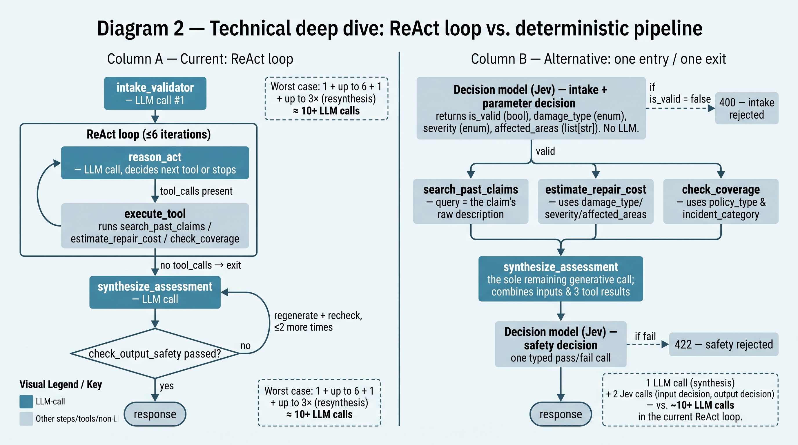

# Claim Triage Agent

A home-damage claim triage service that takes a claim submission (photo, text description, optional PDF) and produces a structured triage report for an insurance adjuster, backed by a vector-retrieval knowledge base of historical claims and a deterministic, observable five-stage pipeline. Built against the brief in `assignment.md` (the take-home brief, not shipped in this repository) and [starter-kit/api-contract/openapi.yaml](starter-kit/api-contract/openapi.yaml).

## Architecture overview

Chainlit UI → FastAPI backend → structured report. The backend runs a fixed five-stage pipeline: (1) a Jev 1.14 intake + parameter decision, (2) three deterministic tools, (3) one generative synthesis call, (4) a Jev 1.14 output-safety decision with bounded regeneration, and (5) the response terminal. No model sits in the control loop: the tool sequence is fixed, so `search_past_claims`, `estimate_repair_cost`, and `check_coverage` are called directly rather than selected by a tool-binding model. Historical claims are embedded locally and retrieved from Qdrant via `search_past_claims`. All three services (`qdrant`, `api`, `ui`) run via `docker compose`. Both the synthesis LLM and the Jev decision model are served through OpenRouter (`OPENROUTER_API_KEY`, `OPENROUTER_BASE_URL`, `LLM_MODEL`, `DECISION_MODEL`, `DECISION_ENDPOINT` in `starter-kit/.env`).

**API surface** (`starter-kit/api-contract/openapi.yaml`): `POST /api/v1/claims/triage`, `GET /api/v1/claims/{id}`, `GET /api/v1/agent/trace/{id}`, `GET /api/v1/health`.

## Setup

From `starter-kit/`:

```sh
make setup   # build + start qdrant, api, ui; embeds the historical-claims corpus into Qdrant
make test    # backend (tests/backend) + frontend (tests/frontend) unit suites
make grade   # public auto-grader (make grade-smoke for a fast 3-case subset while iterating)
make eval    # retrieval-quality eval for search_past_claims (backend/evals/)
```

API: `http://localhost:8000/api/v1/health` · UI: `http://localhost:3000`.

## Model, framework and vector DB choices

- **Generative LLM: an OpenAI-compatible model served via OpenRouter** (`OPENROUTER_API_KEY`, `OPENROUTER_BASE_URL`, `LLM_MODEL` in `.env`). Used for exactly one stage — the synthesis call that writes the report's free text — so a successful pass costs a single LLM call instead of one per step. OpenRouter was chosen so the concrete model can be swapped by changing `LLM_MODEL` alone, with no code change.

- **Decision model: TypeSafe's Jev 1.14, via OpenRouter's Decisions API** (`DECISION_MODEL`, `DECISION_ENDPOINT` in `.env`, reusing `OPENROUTER_API_KEY`). Jev answers typed questions (`noul`/`choice`) with calibrated probabilities and generates no text, which is what the two structured-decision stages need — intake + parameter extraction (multimodal: photos are passed inline) and the text-only output-safety gate. Its request format is isolated behind `app/llm/decision_model_client.py`, so the pinned model can change without touching the pipeline.

- **Framework: LangChain; LangGraph removed.** LangChain's `with_structured_output` still gives the one remaining LLM call (synthesis) a typed schema. The LangGraph `StateGraph` that used to model the ReAct loop is gone: the pipeline is a fixed sequence, so a plain async function expresses it more directly, and the `reason`→`act`→`observe` trace in `GET /agent/trace/{id}` is reconstructed from the pipeline's own step records rather than from graph state.

- **Embeddings: local `BAAI/bge-small-en-v1.5`** via `sentence-transformers`, run in-process (no external embedding API, no added per-call cost or latency). The ~30-record historical-claims corpus is small and well-structured, so a lightweight local model is enough. One combined embedding is built per claim (description + adjuster notes together) rather than embedding the two fields separately. It is much simpler, and the two are short enough that the redundancy didn't hurt retrieval in practice.

- **Vector DB: Qdrant**, as provided by the starter kit's `docker-compose.yml`; not swapped, since it was already a good fit.

Retrieval quality for `search_past_claims` itself (independent of the auto-grader's own RAG checks) is measured by `make eval` (`starter-kit/backend/evals/`): 14 hand-written adjuster-style queries, phrased generally rather than reusing the exact nouns a knowledge-base record uses for itself, run against the real knowledge base and the real embedding model. Current result: Recall@5 100%, MRR 0.952 — see `RESULTS.md`.

## Key design decisions / trade-offs

- **A deterministic pipeline with a fixed nominal model-call budget** (1 generative LLM call + 2 Jev decision calls per successful pass, rising to a bounded worst case of 3 LLM calls + 4 Jev calls if the output-safety retries are exhausted), replacing the previous LLM-driven ReAct loop. The tool sequence is fully determined by the claim's own fields once intake has run, so routing it deterministically drops the loop's per-step reasoning calls without losing the observable trace. See the deep dive below and [`.plans/deterministic-jev-pipeline-plan.md`](.plans/deterministic-jev-pipeline-plan.md).

- **Synthesis stays its own LLM call** rather than being folded into a decision node, so the structured-output schema call stays isolated from the deterministic steps and the safety-retry path (below) can regenerate just the assessment from the carried classification and tool results, without re-running the tools.

- **Output safety checking with bounded retries**: a text-only Jev 1.14 decision call scores the synthesized assessment against five checks (coverage promises, legal advice, settlement figures, liability, emotional language); on failure the assessment is regenerated up to `MAX_SAFETY_CHECK_ATTEMPTS` times before the request fails with a 422. Neutral disclosure of the policy's own terms is allowed and is not treated as a coverage promise.

- **In-memory report/trace storage.** Fine for a single demo session; doesn't survive a restart or scale across instances.

- **Chainlit UI fakes assistant-style token streaming** over an already-complete JSON response (the API contract is a single `application/json` response, not SSE) purely for UX, chunked in groups (`starter-kit/frontend/utils/message_streaming.py`) rather than token-by-token, which also avoids fighting with Chainlit's own message-pinning layout recalculation.

### Deep dive: from the ReAct loop to a deterministic pipeline



The previous design drove every "intelligent" step with an LLM: intake validation, a LangGraph ReAct loop that reasoned about which of three tools to call, a synthesis call, and the output safety check — roughly 10+ LLM calls in the worst case. Most of what the loop "reasoned" about is determined by the claim's own fields once intake has run (`search_past_claims` needs the raw description, `estimate_repair_cost` needs `damage_type`/`severity`/`affected_areas`, `check_coverage` needs `policy_type`/`incident_category`), so the loop was spending model latency on a decision that is effectively fixed.

That recommendation is now implemented (Diagram 2, column B). The ReAct loop and its LangGraph `StateGraph` were removed and replaced by the five-stage pipeline above: one multimodal Jev 1.14 decision call for intake and parameter extraction, the three tools called directly, one generative synthesis call, and one text-only Jev 1.14 decision call for output safety. Jev returns typed answers with calibrated probabilities and no free text, is served through OpenRouter's Decisions API on the existing `OPENROUTER_API_KEY`, and — per its provider — answers in roughly 200–300 ms while billing on input tokens only. The observability the loop provided is kept: `GET /api/v1/agent/trace/{id}` still returns `reason`→`act`→`observe` steps, now 18 of them (6 operations × reason/act/observe) reconstructed from the pipeline's step records rather than from a model's message history.

## Next steps

- Re-measure end-to-end latency and re-run the grader on the deterministic pipeline in the grading environment (`make grade`, `make eval`); the figures in `RESULTS.md` predate this refactor.
- Move claim/trace storage to durable, shared storage if this goes beyond a single-session demo.
- Revisit combined vs. separate description/notes embeddings if the historical-claims corpus grows large enough for retrieval relevance to matter more.

## Results

Test counts, auto-grader scores, accuracy/latency measurements and full limitations are recorded in [RESULTS.md](RESULTS.md), with the deterministic refactor's design in [`.plans/deterministic-jev-pipeline-plan.md`](.plans/deterministic-jev-pipeline-plan.md). AI-assistant usage and delegation is disclosed in [AI_USAGE.md](AI_USAGE.md).
